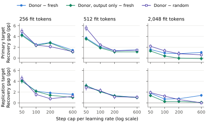
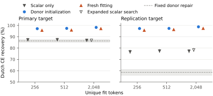

::: {.content-visible when-format="html"}
::: {.study-resources}
[Short summary](explainer.qmd) · [PDF](index.pdf) · [Study guide](https://github.com/sergeisoly/interesearch/blob/v0.3.0/papers/guides/repair-transfer.md)
:::
:::

## Introduction {#sec-question}

A repair is an extra weight update that restores a capability damaged by fine-tuning while preserving the intended change. If the same recipe causes similar damage on a second run, an earlier repair could save work in two ways. Its directions might already be right, so that only their strengths need fitting. Or the directions might give training a head start, even if they eventually need to change. Fitting a new repair from scratch tests how much that head start is worth.

Scaled weight updates have been used in task arithmetic [@ilharco2023editing] and safety repair [@bhardwaj2024resta; @wang2026safegene]. Transferring a fitted initialization has a precedent in soft prompts [@vu2022spot]. Here the same learned donor repair supplies both comparisons, and the outcome is recovery of next-token prediction loss.

## Experimental design {#sec-setup}

Three independent fine-tunes began from Goodfire's four-layer, 67M-parameter language model [@bushnaq2026interpreting, sec. 3.1]. They used the same objective and selected learning rate, with different seeds and samples of Europarl debates [@koehn2005europarl]. Each deliberately raised German cross-entropy (CE, the mean next-token prediction loss). Dutch was outside the objective, so an increase in Dutch CE measures collateral damage. One fine-tune, the *donor*, supplied a repair learned on 73,728 prediction positions. The other two were targets for transfer.

<span id="what-the-repair-changes"></span>The repair adds one learned update to each of 24 attention and MLP weight matrices. Each update has the LoRA form $E_m=b_m a_m^\top$ with rank at most one [@hu2022lora]. Applied to an input $x$, the repair reads one scalar $a_m^\top x$ and adds $b_m(a_m^\top x)$ to the output. A coefficient can strengthen, weaken or reverse this change. Training the vectors can also change which inputs produce a response and where the response goes.

<span id="tbl-families"></span>Every target repair had to fit within the Frobenius norm of the target's fine-tuning update, computed across all 24 matrices. Methods that reused the donor started from the same repair, scaled down uniformly if needed to satisfy that cap. **Scalar fitting** learned one coefficient per matrix (24 parameters). **Donor initialization** trained both vectors (55,296 parameters). **Fresh fitting** trained both vectors from a zero update, with random input vectors and zero output vectors. One control trained only the donor's output vectors. Another trained both vectors from random directions matched to the donor vectors' lengths.

<span id="how-the-repairs-are-fit-and-compared"></span>Fitting minimized three equally weighted KL divergences between next-token distributions. The teacher was the base model for Dutch, and the fine-tuned model for German and a pool of four languages the fine-tune sought to preserve (English, French, Spanish and Italian). **Dutch CE recovery** measures the fraction of the fine-tune's excess Dutch loss that the repair removed. A repair with 0% recovery leaves all the extra loss in place. At 100% recovery, Dutch CE returns to the base-model value.

The targets had disjoint fine-tuning dates. They shared the repair-fitting windows, the checkpoint-selection windows and the final evaluation windows. Repair fitting used nested sets of 256, 512 or 2,048 prediction positions. At each step cap (50, 100, 200 or 600), checkpoints from four learning-rate runs were eligible for selection. Checkpoint selection used 32 separate Europarl session dates to rank candidates by Dutch CE recovery subject to limits on German and retain-language changes. The final evaluation measured recovery and rechecked those limits on 92 further dates. Paired 95% bootstrap intervals resample those dates jointly across repairs within each target. They describe uncertainty over evaluation text for the fitted repairs.

## Results {#sec-results}

### How much can fixed directions recover? {#sec-fixed}

The two fine-tunes raised Dutch CE by 0.187 and 0.189 nat/token. Applying the donor repair without further fitting removed 86.3% of this damage on the first target and 58.6% on the second. <span id="the-primary-test-of-fixed-directions"></span>The primary test compared donor initialization with an expanded scalar search at the full budget of 2,048 fit tokens and a 600-step cap for ordinary training. The scalar search included 48 ordinary checkpoints and two further projected-gradient runs, giving it the larger search budget. Both extra runs met their stopping criteria on each target, and both selected repairs on each target passed the evaluation constraints.



Both paired intervals lie entirely above the prespecified margin of 3 percentage points (pp) (@tbl-primary). The extra scalar search kept the ordinary checkpoint on the first target and raised recovery from 77.3% to 78.4% on the second. The gap was already visible on the fitting text. There the selected scalar repairs removed 87.0% and 79.2% of Dutch KL divergence from the base model, while every method that trained a vector removed at least 98.4%. Other coefficient choices or a larger norm cap could give different results.

Across the three token budgets, with a 600-step cap, ordinary scalar fitting stayed below 90% recovery on both targets, while donor initialization and fresh fitting exceeded 95% (@fig-recovery).

Training only the donor's output vectors recovered 97.1% and 97.4% at full budget. Most of the improvement over rescaling was therefore attainable while the input directions stayed fixed.

### When does the donor start help? {#sec-warm}

At 256 fit tokens and 50 steps, donor initialization recovered 4.4 and 4.1 pp more than fresh fitting on the two targets. It also led the norm-matched random start by 4.9 and 4.5 pp. At this setting there was one seed per control and one shared set of fitting positions.

{#fig-warm-start width="100%" fig-alt="Each row shows one target and each column a token budget. The donor's advantage over the fresh and random starts is larger at 256 tokens and 50 steps than at 2,048 tokens and 600 steps. Intermediate differences vary with the step cap."}

With 2,048 tokens and up to 600 steps, the first fresh start recovered 97.2% and 97.4%. The donor's paired leads were 1.1 pp [0.8, 1.3] and 1.4 pp [1.1, 1.7]. Both intervals fit inside the prespecified ±2 pp equivalence band. A second fresh seed recovered 98.2% and 98.0%. Against the first norm-matched random start at full budget, the donor led by 0.6 pp [0.3, 0.9] on the primary target and 0.01 pp [−0.26, 0.28] on replication. The first fresh seed reused the random input vectors from which the donor had originally been trained, so its comparison with the donor measures the value of the whole fitted start.

### What does reuse save? {#sec-cost}

The first fresh fit at full budget served as the quality reference. A setting qualified if its selected repair passed the evaluation constraints and the lower bound of its paired recovery difference from the reference exceeded −2 pp. After evaluation I chose the cheapest qualifying setting separately for each method and cost measure.

On each target, the fewest **fit-token presentations** needed by donor initialization were 51,200 (256 positions × 50 steps × four learning rates). Fresh fitting needed 409,600 (2,048 × 50 × four). Allowing 600 steps let both methods qualify with just 256 distinct fitting positions. On this grid, donor initialization needed one eighth as many presentations as fresh fitting to reach the reference. The minimum amount of distinct text was the same.

Training the donor repair had itself cost 3,686,400 presentations. If each new target saved the observed 358,400 presentations and the donor fine-tune already existed, reuse would pay back this cost on the eleventh target. Changing the reference to the second fresh seed in a post hoc analysis moved payback to the fifth target. The experiment did not measure an end-to-end time saving. [Cost accounting](#sec-app-cost)

## Discussion {#sec-limits}

<span id="sec-conclusion"></span>The output-only fits inherited the donor's input directions and its trained output vectors. How much did the input directions themselves contribute? Two output-only fits starting from zero outputs, one with donor inputs and one with norm-matched random inputs, would test that question from identical initial updates.

Bushnaq scaled a German-related component from a decomposition of this same model's base weights [@bushnaq2026interpreting; @bushnaq2026exploration]. Here the directions came from fitting a repair to Dutch text. A corresponding test for a decomposition-derived component would compare its attainable training loss with that of a trainable update under a common rank and norm budget.

The evidence comes from one donor that had already passed a recovery check, two independently trained targets, one recipe and one base model. Additional donors, training windows and seeds would be needed to estimate how often the early advantage recurs. The measured outcome is prediction loss on these languages. The experiment leaves the internal mechanism of repair and transfer to other capabilities open.

**AI assistance.** I used OpenAI Codex and Anthropic Claude for planning, coding, analysis and writing, and Scientific Agent Skills [@kassis2026scientific] for manuscript review.

## References {.unnumbered}

::: {#refs}
:::

```{=latex}
\compactappendix
```

## Appendix — Selection, checks and reproduction {#sec-app-methods .unnumbered}

<span id="sec-reproduction"></span>The [study guide](https://github.com/sergeisoly/interesearch/blob/v0.3.0/papers/guides/repair-transfer.md) links the recipe, token windows, donor repair and saved measurements, with commands for replay and retraining.

### Checkpoint selection {.unnumbered}

The fine-tunes trained full-matrix updates for 200 steps, penalizing a German CE increase below 1 nat/token and drift from the base model on the four retain languages. The donor repair passed an 80% Dutch CE recovery threshold on 112 dates. The target fine-tunes used disjoint sets of 64 dates each drawn from the pool originally set aside for donor evaluation. Target repair fitting, selection and final evaluation used dates outside the donor sets.

Half the target repair's fit tokens came from Dutch and a quarter each from German and the pooled retain languages. Full-batch Adam [@kingma2015adam] supplied checkpoints every 50 steps. On selection text a candidate had to preserve 90–110% of the German CE increase and reduce Dutch KL from the base. Its German KL from the fine-tune, $D_{\mathrm{KL}}(p_{\text{fine-tuned}}\|p_{\text{repair}})$, had to be at most 5% of the corresponding KL with the base model in place of the repair. Qualifying checkpoints were ranked by Dutch CE recovery, with ties broken by smaller norm and then listing order. The first of the top five with a CE increase of at most 0.01 nat/token above the fine-tuned model on every retain language advanced to evaluation.

### Primary comparison and uncertainty {#sec-app-checks .unnumbered}

For the primary comparison to count, the lower 95% bound on the target's Dutch CE increase had to reach 0.025 nat/token. It reached 0.178 and 0.180 on the two targets. The selected repairs had to pass the selection constraints again on evaluation text. Each of the two additional scalar runs, starting from the donor coefficients and the best ordinary checkpoint by fit loss, had to satisfy the prespecified numerical checks. The runs stopped on relative loss decrease in three cases and at the line-search floor with sufficiently small projected gradient in the fourth. These local checks apply within the tested norm cap. [Evaluation constraints and results](https://github.com/sergeisoly/interesearch/blob/v0.3.0/results/repair_transfer/tables/readout_table.md){#tbl-readout} · [Optimizer settings](https://github.com/sergeisoly/interesearch/blob/v0.3.0/src/interesearch/repair_transfer/recipe.yaml){#tbl-lrs} · [Optimizer results](https://github.com/sergeisoly/interesearch/blob/v0.3.0/results/repair_transfer/analysis.json){#tbl-polish}

Each of 5,000 bootstrap replicates computed recovery from mean losses over resampled dates [@efron1979bootstrap]. Five specified secondary comparisons had a ±2 pp equivalence margin. The protocol set this margin and the 3 pp primary margin without a separate empirical justification. Secondary intervals are descriptive and unadjusted for multiple comparisons. My dated records place these rules before target fine-tuning and evaluation. They lack independent timestamps. [Secondary contrasts](https://github.com/sergeisoly/interesearch/blob/v0.3.0/results/repair_transfer/tables/secondary_table.md){#tbl-secondary}

### Cost accounting {#sec-app-cost .unnumbered}

The minimum of 256 distinct fit positions for fresh fitting depended on the reference. Its lower bounds cleared the −2 pp cutoff by just 0.015 and 0.043 pp. Using the second fresh seed as the reference raised the minimum to 2,048 for fresh fitting while donor initialization still qualified at 256. Unique-token costs also include 57,344 shared selection positions. Presentations count training across the four learning rates and exclude selection forward passes. Estimated GPU seconds include training and selection but exclude final target evaluation, the initial damage check and exploration of other settings. On the two targets, estimated times at the cheapest qualifying settings were 14.5 and 13.9 seconds from the donor, versus 16.8 and 17.1 from scratch. The estimated one-time donor cost was 336 GPU seconds. [Complete cost comparison](https://github.com/sergeisoly/interesearch/blob/v0.3.0/results/repair_transfer/tables/break_even_table.md){#tbl-break-even} · [Recovery against training cost](https://github.com/sergeisoly/interesearch/blob/v0.3.0/results/repair_transfer/figures/reach.svg){#fig-reach}

### Portuguese (post hoc) {#sec-portuguese .unnumbered}

Portuguese took no part in fitting or checkpoint selection. On the same 92 evaluation dates, the full-budget scalar repairs raised Portuguese CE over the respective fine-tunes by 0.00115 and 0.00114 nat/token. Donor initialization lowered it by 0.00064 and 0.00069, and the first fresh fits lowered it by 0.00135 and 0.00142. The six pointwise 95% intervals exclude zero. [Paired intervals and cost sensitivity results](https://github.com/sergeisoly/interesearch/blob/v0.3.0/results/repair_transfer/posthoc.json)

### Recovery across fitting budgets {.unnumbered}

{#fig-recovery width="100%" fig-pos="H" fig-alt="Two panels compare Dutch CE recovery on the primary and replication targets. Donor initialization and fresh fitting exceed 95% at 256, 512 and 2,048 fit tokens. The scalar-only fits stay below 90%, including the expanded search at 2,048 fit tokens. A dashed line marks the fixed donor repair and a shaded band gives its interval."}

::: {.content-visible when-format="html"}

<details>
<summary>Cite this version (0.2.0)</summary>

```bibtex
@misc{solovev2026repair,
  author = {Solovev, Sergei},
  title  = {Transferring Learned Repairs Between Fine-Tunes},
  year   = {2026},
  month  = nov,
  note   = {Version 0.2.0},
  url    = {https://sergeisoly.github.io/interesearch/repair-transfer/}
}
```

</details>

:::
