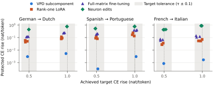
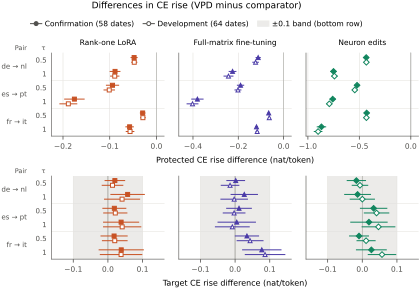

::: {.content-visible when-format="html"}
::: {.study-resources}
[Short summary](explainer.qmd) · [PDF](index.pdf) · [Study guide](https://github.com/sergeisoly/interesearch/blob/v0.3.0/papers/guides/selective-editing.md)
:::
:::

## Introduction {#sec-question}

Removing parameters important for Spanish raises perplexity in Portuguese and Italian
[@zhang2024unveiling, Table 11]. This spillover matters for model editing, where a goal is to preserve
predictions outside the intended scope of a change [@yao2023editing, sec. 2]. An edit that does little
to Spanish might also spare Portuguese. Matching the edits on Spanish loss makes their effects on Portuguese easier to
interpret.

adVersarial Parameter Decomposition (VPD) approximates weight matrices with sums of rank-one
*subcomponents*. It rewards approximations that can use few subcomponents on a given input
[@bushnaq2026interpreting, sec. 2].[^vpd-editing] Bushnaq used a subcomponent's interpretation label to select a
direction that suppressed German with little change in English, French or Spanish, though Italian
prediction also worsened [@bushnaq2026exploration]. The selector tested here ranks directions
numerically using only target and English text. For German, Spanish and French targets, the
corresponding tests of collateral damage use Dutch, Portuguese and Italian. Figures and tables call
this second language in each pair *protected*.

[^vpd-editing]: In the VPD report’s emoticon experiment, a LoRA update trained on 947 examples outperformed a manual write-vector edit on both off-target KL measures [@bushnaq2026interpreting, sec. 6].

## Methods {#sec-setup}

### Model and data {#sec-model-data}

Goodfire's base model is a four-layer, 67M-parameter decoder-only language model trained on a subset
of the Pile. Its VPD dictionary contains 38,912 subcomponents across 24 weight matrices
[@bushnaq2026interpreting, sec. 3.1; @gao2020pile]. Damage is the rise from the base model in mean
next-token cross-entropy (CE), in nat/token.

Each European Parliament session date contributes one window per language, with 256 next-token
predictions. Windows begin at the same aligned speaker turn, then each language is tokenized and
truncated independently [@koehn2005europarl]. For each target, selection and training use three
overlapping draws of 64 out of 128 training windows. All draws share 256 English windows from
Europarl, WikiText-2 and the Pile [@merity2017pointer; @gao2020pile]. The learned updates use a
different seed for each draw.

### Selecting a subcomponent {#sec-selection}

A rank-one subcomponent $A_c=u_cv_c^\top$ reads one scalar $v_c^\top x$ from the input and adds
$u_c(v_c^\top x)$ to the output. In its weight matrix $W$, the original coefficient is 1. An edit
$W'=W+\alpha A_c$ changes the coefficient to $1+\alpha$, keeping both directions fixed. A zero
coefficient removes the contribution and a negative coefficient reverses it.

A candidate ranks highly when a small coefficient change is expected to raise target loss at little
cost in English predictions. If $g_c$ is the derivative of mean target CE along $A_c$, an edit of size
$\alpha$ changes target CE by approximately $\alpha g_c$. On English text, the Kullback–Leibler (KL)
divergence from the base model is approximately $q_c\alpha^2/2$, where $q_c$ estimates directional
Fisher curvature. The score is
$$\frac{g_c^2}{q_c+\varepsilon\lVert A_c\rVert_F^2}.$$
The floor in the denominator limits the influence of small curvature estimates. After re-ranking the
top 64 candidates on further English text, the search tests them in order on target training text at
$\alpha=\operatorname{sign}(g_c)\,a$, increasing $a$ up to 2. The first direction to reach 1 nat/token
of damage is selected, or the first to reach 0.5 if none reaches 1.

### Comparison methods {#sec-comparators}

Rank-one LoRA [@hu2022lora] learns both factors of an update in layer 0's attention output matrix,
matching the rank and location of all three selected VPD subcomponents. Full-matrix fine-tuning can
change all 24 matrices. Both train for 200 steps with a hinge penalty for target CE rises below 1
nat/token on each window and an equally weighted penalty on English KL divergence. The neuron
comparator ranks MLP neurons by the difference in activation frequency between target text and
English, then reduces the output weights of the top-ranked neurons [@tang2024language;
@kojima2024multilingual]. A fourth comparator applies the VPD selection rule after random signed
permutations of the input and output coordinates within each dictionary matrix. This preserves the
subcomponents' norms and pairwise angles while changing their alignment with the model's weights.

### Calibration and evaluation {#sec-calibration}

Each edit must raise mean CE on 32 target validation windows to within 0.02 nat/token of $\tau=0.5$ or 1.
The edit then stays fixed. For each target, all three draws selected the same subcomponent and the
same two doses, yielding six distinct VPD edits. Three reduced the coefficient while keeping it
positive, and three reversed its sign (@tbl-interventions).

::: {#sec-access}

[Earlier work]{#sec-access-details} used Dutch, Portuguese and Italian development text, as well as
Dutch and Italian text from NTREX [@federmann2022ntrex]. I had previously selected the German
subcomponent with Dutch in view. On 11 October 2026, I fixed the methods and main analysis before the
64-date development evaluation. The same edits were evaluated once on 58 further dates under an
amendment fixed before parsing those windows. My records document this chronology without an
independently timestamped preregistration.

:::

::: {#sec-analysis}

An edit was eligible for confirmation only if mean English CE rose by at most 0.1 nat/token on every
development and confirmation check. Each contrast is the difference in related-language CE rise (VPD
minus comparator) for a given pair and dose, averaged over matched, eligible draws and then over
dates. Simultaneous 95% intervals resample session dates with the edits, training runs and language
pairs held fixed. The prespecified tolerance for each edit's achieved target effect on evaluation text
was $\tau\pm0.1$ nat/token.

:::

## Results {#sec-results}

### Related-language damage {#sec-effects}

On the 58 new dates, all matched edits in the main comparison passed the English checks and met the
target tolerance (@fig-effects). The six VPD edits raised related-language CE by 0.0003–0.0053
nat/token. The individual comparator edits raised it by 0.027–0.236 for LoRA, 0.058–0.407 for
full-matrix fine-tuning and 0.423–0.876 for neuron edits.

{#fig-effects width="100%" fig-alt="For each language pair, the edits cluster into two bands of achieved target damage. At both levels the VPD points lie below every comparator on the related-language axis."}

::: {#sec-contrasts}

All 18 estimated contrasts had simultaneous 95% intervals below zero. At $\tau=1$, for example, the
German VPD edit raised Dutch CE by 0.089 nat/token less than LoRA (VPD minus LoRA, −0.100 to −0.077).
Each fixed VPD edit enters three contrasts. The six planned randomized-dictionary contrasts have no
estimates. None of the nine randomized searches reached even 0.5 nat/token within the dose limit.

:::

### Achieved target effects {#sec-agreement}

Meeting the per-edit tolerance still allows two methods to differ in achieved target damage. In a post
hoc analysis, 15 of 18 simultaneous intervals for the *difference* in achieved target CE rise lay
wholly within ±0.1 nat/token. In all three exceptions the mean target CE rise was larger for VPD
(@fig-contrasts). Each VPD edit raised target CE on every confirmation window. Related-language CE
rose on 30–47 of the 58 windows per edit, with a maximum single-window rise of 0.037 nat/token.

{#fig-contrasts fig-pos="H" width="100%" fig-alt="All 18 confirmation intervals for differences in related-language damage lie below zero. For achieved target effects, 15 of 18 confirmation intervals lie within the agreement band."}

### Preservation of English predictions {#sec-english}

CE measures loss on the observed next token. KL divergence
$D_{\mathrm{KL}}(p_{\mathrm{base}}\,\|\,p_{\mathrm{edit}})$ measures the change across the full prediction distribution. In this post hoc comparison,
LoRA and full-matrix fine-tuning each preserved English predictions better than VPD in all 18
target–dose–draw comparisons on the new dates. Both objectives directly penalized English KL. The VPD
edits' mean English KL was below 0.001 nat/token (@tbl-effects). On the related languages, all 18
simultaneous intervals for VPD minus comparator KL lay below zero.

```{=latex}
\Needspace{20\baselineskip}
```



### Stronger learned comparators {#sec-extended-comparisons}

The original runs chose the highest learning rate tested for LoRA and the lowest for full-matrix
fine-tuning. An exploratory comparison on the previously evaluated development dates used 2,000
training steps, wider learning-rate grids, a larger hinge margin and three seeds per draw. This recipe
reduced mean related-language damage in five of six target–dose combinations for LoRA and all six for
full-matrix fine-tuning. VPD still caused less damage in all 12 comparisons, with mean target effects
differing by at most 0.07 nat/token. Several settings changed together and convergence remains
unestablished.

## Discussion {#sec-limits}

### What the choice of direction contributes {#sec-references}

Within the VPD dictionary, selecting the subcomponent most aligned with a learned update or selecting
by the target-minus-English difference in VPD's learned causal-importance scores caused at least as
much related-language damage wherever comparisons were possible. At similar target effects, the
importance rule raised related-language CE by 0.48–1.37 nat/token more than the main selector on the
new dates. These comparisons are descriptive and some include fewer than three draws.

Bushnaq's previously reported direction in layer 3 (attention value, index 513) caused less Dutch
damage than the selected direction in layer 0 (attention output, index 268). At a German validation
target of 0.5 nat/token, a post hoc scan found Dutch CE rises of 0.0012 and 0.0036 nat/token,
respectively, on the 64 development dates. The scan left achieved German test damage, English
eligibility and Italian damage unmeasured.

::: {#sec-null}

Two further controls tested directions outside the VPD dictionary on development text. A rank-one direction computed from target
gradients and approximate English Fisher curvature [@martens2015optimizing] damaged the related
languages more, but borrowed the selected VPD subcomponent's norm and the selector's curvature floor.
Every edit to a singular component of the weight matrices that reached the target effect exceeded
the English CE limit. These controls leave the decomposition's contribution open.

:::

### Scope {#sec-scope}

::: {#sec-conclusion}

Six fixed subcomponent edits spared related-language predictions better than the tested comparators at
similar mean target damage. The learned updates better preserved the English predictions their
objectives protected. Providing those objectives with related-language examples could change this
ordering. Confirmation tests these edits on new parliamentary text in one model. How the selector
performs on new languages or models, and whether the directions implement a language-specific
mechanism, remain open.

:::

::: {#sec-reproduction}

**Code and data.** Per-date measurements support a replay of the analysis, including the post hoc
window and German shortlist checks. Rerunning the confirmatory model evaluation requires the
unpublished text windows.
[Study guide](https://github.com/sergeisoly/interesearch/blob/v0.3.0/papers/guides/selective-editing.md)

:::

**AI assistance.** I used OpenAI Codex and Anthropic Claude for planning, coding, analysis and writing, and Scientific Agent Skills [@kassis2026scientific] for manuscript review.

```{=latex}
% Keep the final reference with the bibliography at the body font size.
\apptocmd{\CSLReferences}{\setlength{\itemsep}{0.25\baselineskip}}{}{}
```

## References {.unnumbered}

::: {#refs}
:::

```{=latex}
\compactappendix
\widowpenalty=10000
```

## Appendix — Estimation and comparison details {#sec-app-methods .unnumbered}

**Selection and tuning.** The Fisher estimate averages squared directional scores from eight
model-sampled label sets per English window [@martens2020new; @kunstner2019limitations]. The floor
$\varepsilon$ is the first percentile of $q_c/\lVert A_c\rVert_F^2$. Shortlisted candidates are ranked
again using the larger of two curvature estimates, the second from 256 other English windows.
GPU-dependent label sampling affects reproducibility. Selector reruns verified the first German draw
on the L40S for VPD and one randomized dictionary. The curvature check failed on the tested A10 and
L4.

For neuron edits, calibration chooses the smallest power-of-two count from 1 to 256 whose full removal
reaches $\tau$, then scales the output weights. For each target, the learning rate with the lowest
English validation KL at $\tau=1$ on draw 0 was 0.003 for LoRA and $10^{-6}$ for full-matrix
fine-tuning. Calibration can scale the learned update down.

::: {#sec-app-readouts}

**Evaluation.** The development English CE checks use 64 Europarl windows, 32 WikiText-2 windows and
512 Pile documents. Confirmation uses English from the 58 further dates (48 main and 10 reserve,
analyzed together). The Pile contains European Parliament text, so pretraining overlap is possible
[@gao2020pile, sec. 2.17]. The main analysis specified four comparators, three language pairs and two doses. Intervals use 2,000 shared date bootstrap resamples with a max-$|t|$ critical value
[@efron1979bootstrap; @montielolea2019simultaneous, supplement, Algorithm 3]. The post hoc family uses
20,000 resamples per dataset. Its simultaneous intervals cover 18 method–pair–dose comparisons
across three outcomes jointly: achieved target CE, related-language CE and related-language KL.

:::

::: {#sec-app-extended}

**Alternative directions and training.** The alignment rules normalize each dictionary subcomponent
and select the one with the largest absolute inner product with a learned update. One rule uses a
full-matrix update and the other uses a LoRA update across all 24 matrices. The importance rule adapts
Bushnaq's top-16 ranking to one subcomponent. These comparisons use eligible, matched draws with a
separate simultaneous correction. The expanded training comparison uses unpaired means over matched,
usable runs. Excluding seven of 27 LoRA runs whose final English validation KL exceeded twice its
minimum from step 100 onward gave the same direction of effect. I specified the exploratory
comparisons before the runs and fixed their analysis before development readout, with selection
outcomes and validation effects already known.

:::

::: {#sec-app-claims}

@tbl-interventions identifies the six edits. @tbl-claims gives each comparison and its simultaneous 95% interval.



```{=latex}
\clearpage
```



:::

::: {.content-visible when-format="html"}

<details>
<summary>Cite this version (0.2.0)</summary>

```bibtex
@misc{solovev2026selective,
  author = {Solovev, Sergei},
  title  = {Selective Language Damage with Parameter-Decomposition Subcomponents},
  year   = {2026},
  month  = nov,
  note   = {Version 0.2.0},
  url    = {https://sergeisoly.github.io/interesearch/selective-editing/}
}
```

</details>

:::
